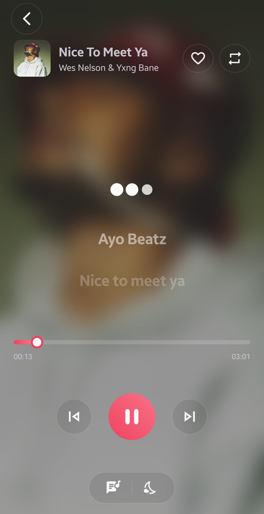
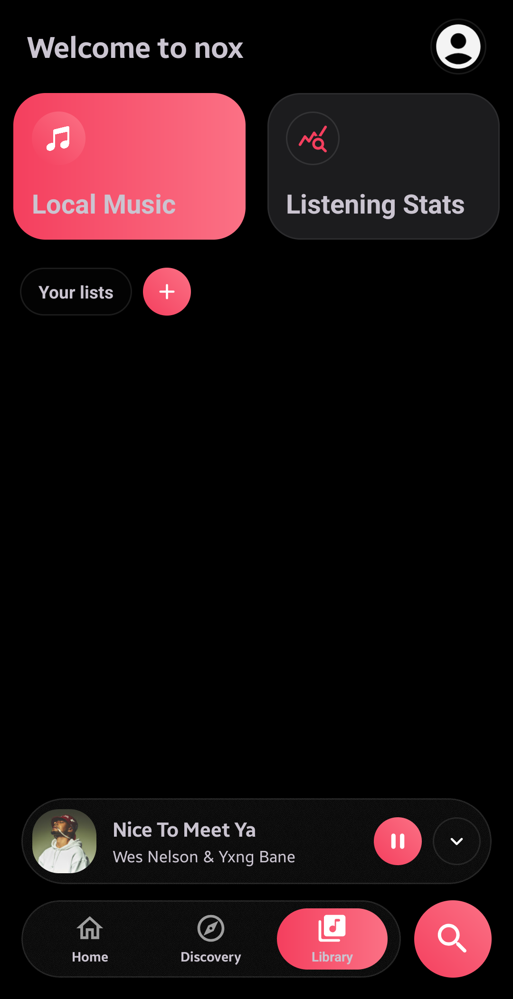

  

<h1 align="center">Nox Sound</h1>

  <b>A fast, ad-free Android music player for local and online tracks. 
  Includes direct audio downloads, background playback, and synced lyrics. 
  Built for clean library control and smooth daily listening.</b>

---

## Features

- **Direct Audio Downloads:** Download songs straight to `Music/Nox` with bitrate selection, fast chunked downloading, organized filenames, and MediaStore support.

- **Smooth Playback:** Stream online audio or play local files with stable background playback and quick queue control.

- **Synced Lyrics:** View real-time synchronized lyrics that scroll smoothly with the current track.

- **Sleep Timer:** Set a custom countdown timer to stop playback automatically.

- **Library & Playlists:** Manage local tracks, favorites, and custom playlists in one place.

- **Clean Dark Interface:** Custom dark cards and focused controls designed without visual clutter.

---

## Screenshots

  <table>
    <tr>
      <td align="center" width="33%">
        
         
        <b>Splash</b>
      </td>
      <td align="center" width="33%">
        
         
        <b>Player</b>
      </td>
      <td align="center" width="33%">
        
         
        <b>Home</b>
      </td>
    </tr>
    <tr>
      <td align="center" width="33%">
        
         
        <b>Lyrics</b>
      </td>
      <td align="center" width="33%">
        
         
        <b>Setting</b>
      </td>
      <td align="center" width="33%">
        
         
        <b>Library</b>
      </td>
    </tr>
  </table>

