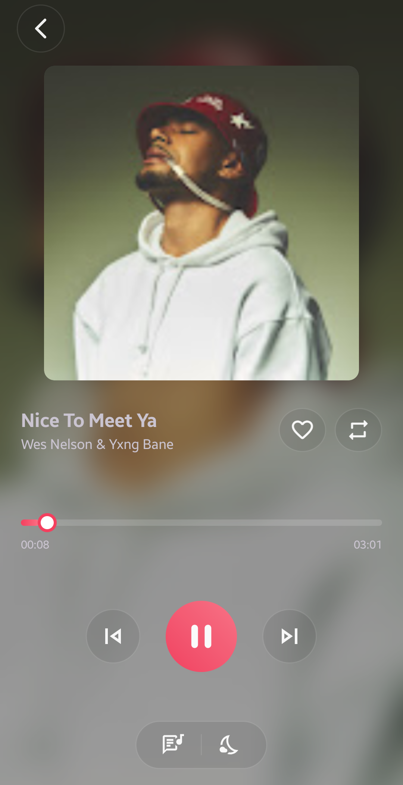
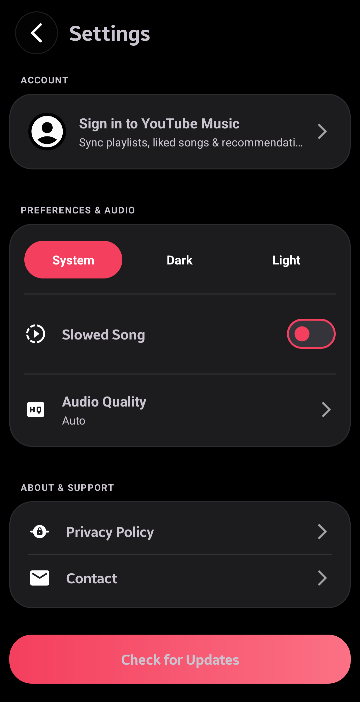

 

  

<h1 align="center">Nox Sound</h1>

  <b>A refined music experience, designed around your sound.</b>

  Nox Sound brings together seamless playback, personalized listening, synchronized lyrics, and a clean interface for a more immersive music experience.

---

## Features

* **YouTube Music Integration**: Connect with YouTube Music to explore your library and enjoy seamless playback.
* **High-Quality Audio**: Experience clear, rich sound with smooth playback.
* **Synced Lyrics**: Follow lyrics in real time with synchronized scrolling.
* **Smart Sleep Timer**: Automatically stop playback with a customizable countdown.
* **Favorites**: Keep your favorite tracks within easy reach.
* **Personal Playlists**: Create and organize your own music collections.
* **Listening Statistics**: Explore your listening habits, top tracks, and playback activity.

---

## Screenshots

  <table>
    <tr>
      <td align="center" width="33%">
        
         
        <b>Splash</b>
      </td>
      <td align="center" width="33%">
        
         
        <b>Player</b>
      </td>
      <td align="center" width="33%">
        
         
        <b>Home</b>
      </td>
    </tr>
    <tr>
      <td align="center" width="33%">
        
         
        <b>Lyrics</b>
      </td>
      <td align="center" width="33%">
        
         
        <b>Settings</b>
      </td>
      <td align="center" width="33%">
        
         
        <b>Library</b>
      </td>
    </tr>
  </table>

---

  <b>Nox Sound</b> 
  Made for the way you listen.

