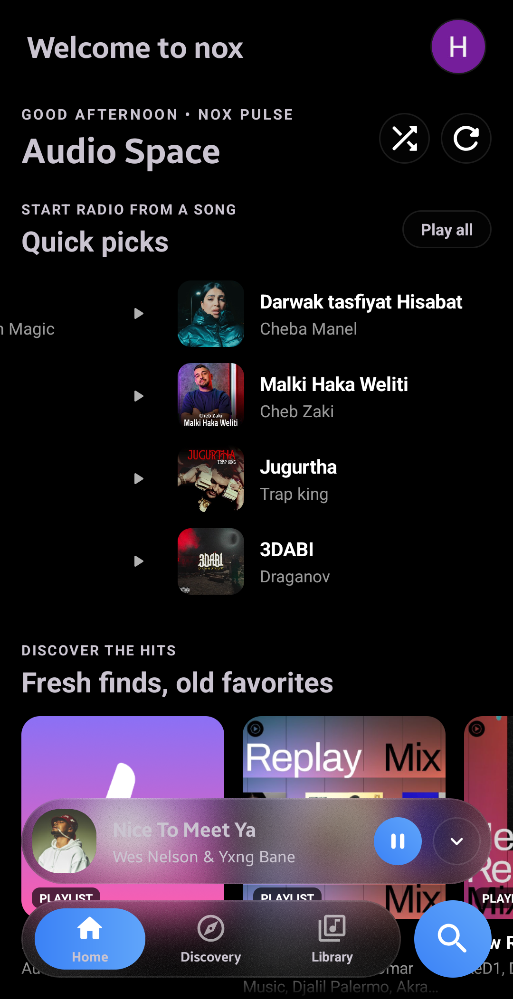
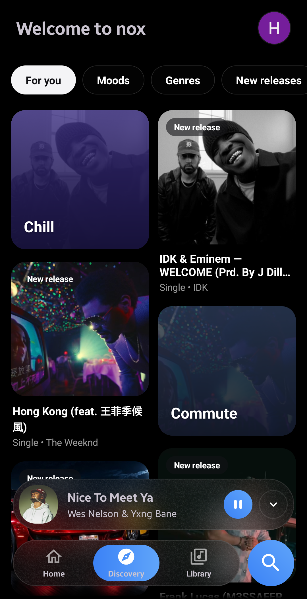
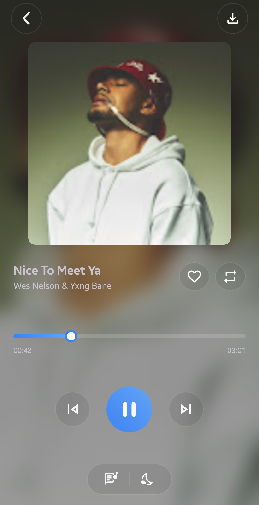
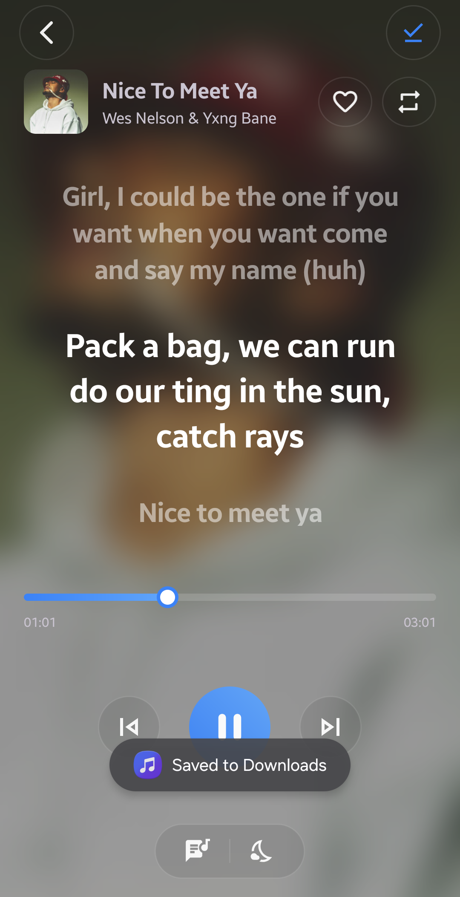
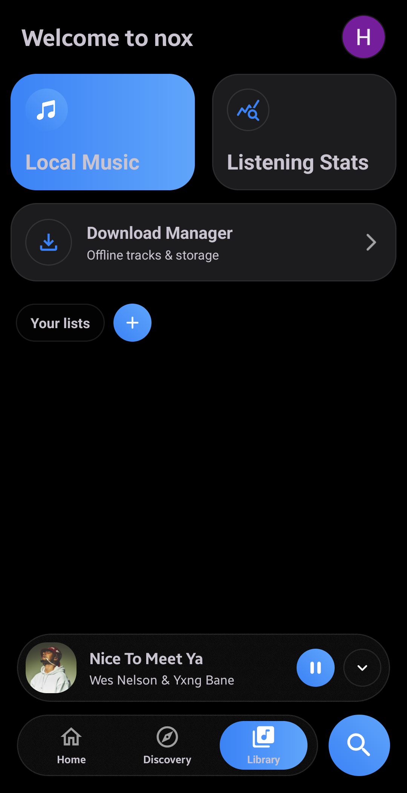
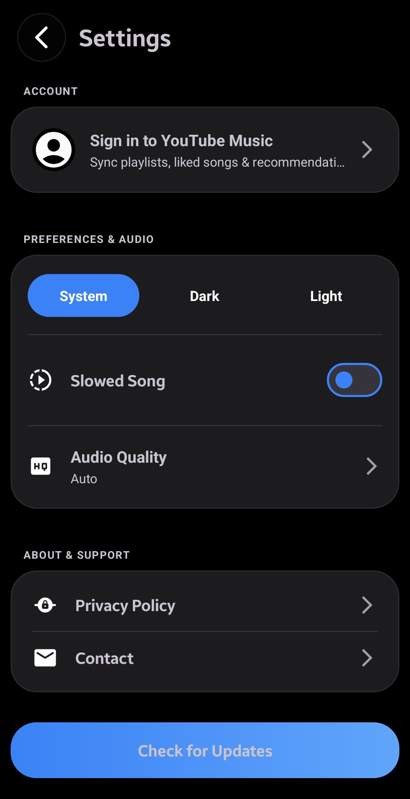

  

<h1 align="center">Nox Sound</h1>

  <b>A music player built for a smooth, responsive, and focused listening experience on Android.</b>

  

  

---

## Features

### Online Streaming & Discovery
Explore trending tracks and stream music smoothly online with smart search, live suggestions, and quick switching between streamed audio and offline files.

---

### Data-Smart Offline Downloads & Cache Reuse
Save tracks for offline listening while reusing already-streamed audio and cached artwork to avoid duplicate downloads, paired with a dedicated Download Manager and stream cache controls.

---

### Instant Offline Playback
Play saved offline tracks immediately with zero extra data usage, even after clearing streaming cache, with multi-select batch deletion and safe back-button handling.

---

### Background Playback & Queue Control
Keep audio running reliably in the background while using other apps, with responsive playback controls, quick track skipping, and flexible queue management for uninterrupted listening.

---

### Real-Time Synced Lyrics
Follow every song line by line with time-synchronized lyrics that track your playback position automatically and scroll smoothly as the music plays.

---

### Smart Sleep Timer
Set a custom countdown timer before sleep or focus sessions so playback stops cleanly on schedule without draining battery overnight.

---

### Favorites & Custom Playlists
Save tracks you love with a single tap and build custom playlists tailored to different moods, sessions, or artists with easy organization.

---

### Redesigned Dark Interface
Experience a refreshed color palette and updated layouts across Home, Discovery, Search, and Settings for clearer hierarchy, frosted glass accents, and smoother everyday navigation.

---

## Screenshots

  <table>
    <tr>
      <td align="center" width="50%">
        
         
        <b>Home</b>
      </td>
      <td align="center" width="50%">
        
         
        <b>Discovery</b>
      </td>
    </tr>
    <tr>
      <td align="center" width="50%">
        
         
        <b>Search</b>
      </td>
      <td align="center" width="50%">
        
         
        <b>Player</b>
      </td>
    </tr>
    <tr>
      <td align="center" width="50%">
        
         
        <b>Lyrics</b>
      </td>
      <td align="center" width="50%">
        
         
        <b>Library</b>
      </td>
    </tr>
    <tr>
      <td align="center" width="50%">
        
         
        <b>Download Manager</b>
      </td>
      <td align="center" width="50%">
        
         
        <b>Settings</b>
      </td>
    </tr>
  </table>

