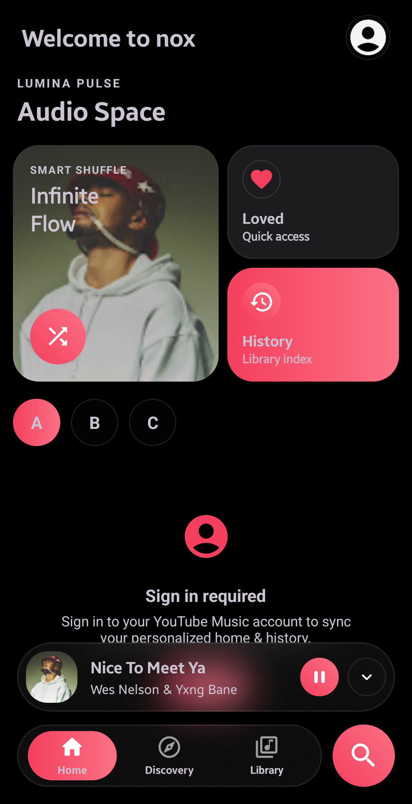

  

<h1 align="center">Nox Sound</h1>

  <b>Nox Sound is a fast, ad-free Android music player built for clean offline and online listening. 
  It combines smooth background playback, direct audio downloads, and synchronized lyrics in a refined dark interface. 
  Designed for effortless library management and complete control over your audio files.</b>

  
  
  

---

## Key Features

- **Direct Audio Downloads:** Download tracks directly to `Music/Nox` with selectable bitrates, chunked high-speed transfers, automatic filename formatting, and MediaStore integration.
- **Hybrid Playback Engine:** Seamlessly stream online tracks or play local audio files with stable background service execution and responsive queue controls.
- **Real-Time Synced Lyrics:** Displays time-synced lyrics with smooth automatic scrolling matched to the current playback position.
- **Smart Sleep Timer:** Configure custom playback countdowns with quick step adjustments to pause audio automatically.
- **Library, Favorites, and Playlists:** Organize local and saved music into custom playlists, mark favorite tracks with one tap, and browse your collection cleanly.
- **Refined Dark Material UI:** Built with consistent card surfaces, custom typography, and uncluttered controls optimized for daily use.

---

## Screenshots

  <table>
    <tr>
      <td align="center" width="33%">
        
         
        <b>Splash</b>
      </td>
      <td align="center" width="33%">
        
         
        <b>Player</b>
      </td>
      <td align="center" width="33%">
        
         
        <b>Home</b>
      </td>
    </tr>
    <tr>
      <td align="center" width="33%">
        
         
        <b>Lyrics</b>
      </td>
      <td align="center" width="33%">
        
         
        <b>Setting</b>
      </td>
      <td align="center" width="33%">
        
         
        <b>Library</b>
      </td>
    </tr>
  </table>

---

## Developer

Maintained by **Hance.Inc** (`Hance-PDv`).
