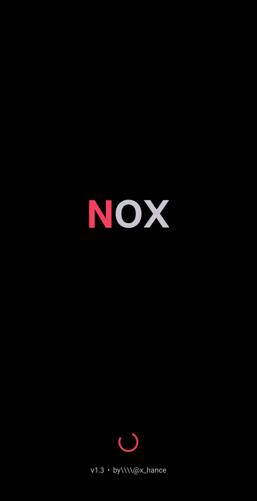

  

<h1 align="center">Nox Sound</h1>

  <b>A music player built for a smooth, responsive, and focused listening experience on Android.</b>

---

## Features

### YouTube Music Account & Online Streaming
Sign in directly with your YouTube Music account to stream your saved and favorite tracks online, access your personal library, and switch smoothly between online playback and local files without leaving the app.

---

### Background Playback & Queue Control
Keep audio running reliably in the background while using other apps, with responsive playback controls, quick track skipping, and flexible queue management for uninterrupted listening.

---

### Real-Time Synced Lyrics
Follow every song line by line with time-synchronized lyrics that track your playback position automatically and scroll smoothly as the music plays.

---

### Smart Sleep Timer
Set a custom countdown timer before sleep or focus sessions so playback stops cleanly on schedule without draining battery overnight.

---

### Favorites & Custom Playlists
Save tracks you love with a single tap and build custom playlists tailored to different moods, sessions, or artists with easy organization.

---

### Clean Dark Interface
Navigate your home feed, player, lyrics, and library through a dark, low-distraction layout built for clarity and fast everyday use.

---

## Screenshots

  <table>
    <tr>
      <td align="center" width="33%">
        
         
        <b>Splash</b>
      </td>
      <td align="center" width="33%">
        
         
        <b>Player</b>
      </td>
      <td align="center" width="33%">
        
         
        <b>Home</b>
      </td>
    </tr>
    <tr>
      <td align="center" width="33%">
        
         
        <b>Lyrics</b>
      </td>
      <td align="center" width="33%">
        
         
        <b>Setting</b>
      </td>
      <td align="center" width="33%">
        
         
        <b>Library</b>
      </td>
    </tr>
  </table>

